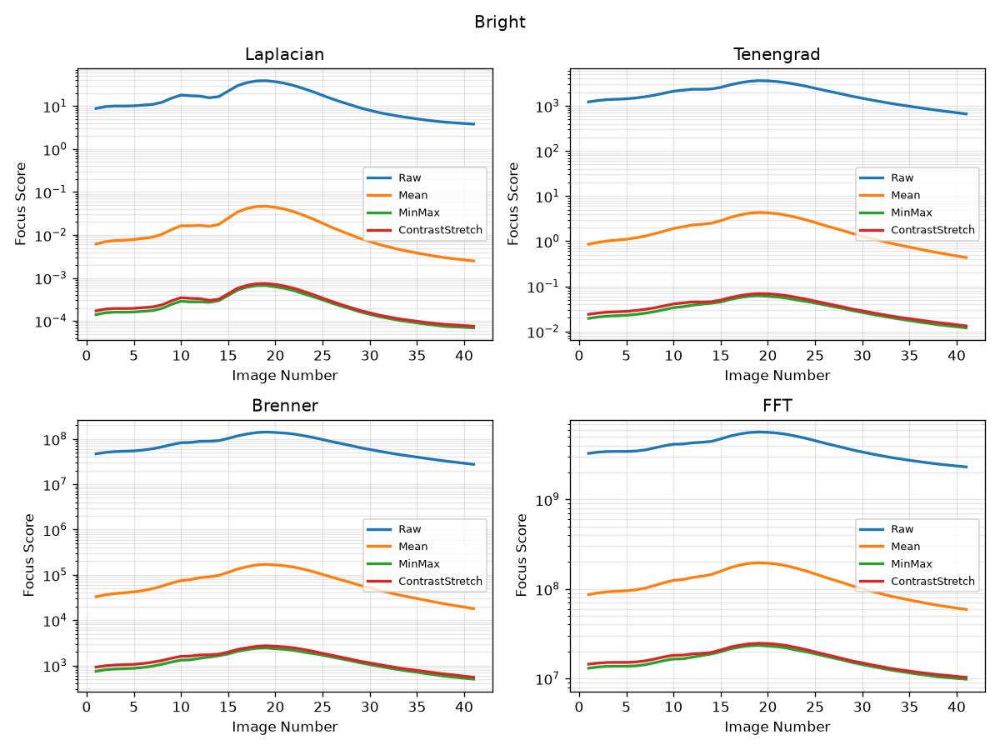
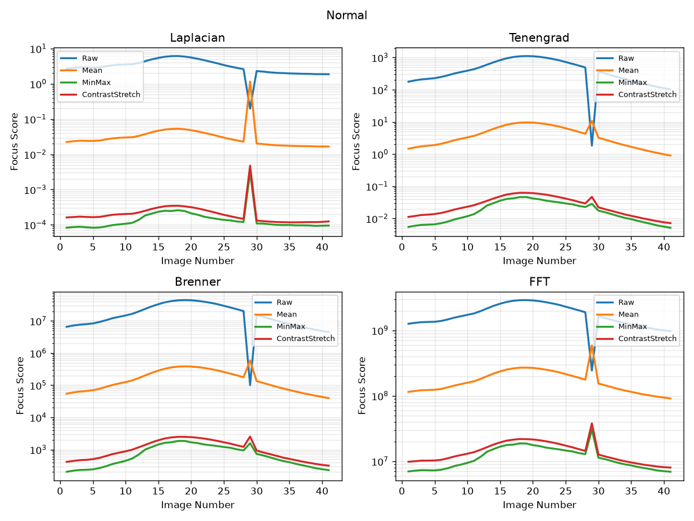
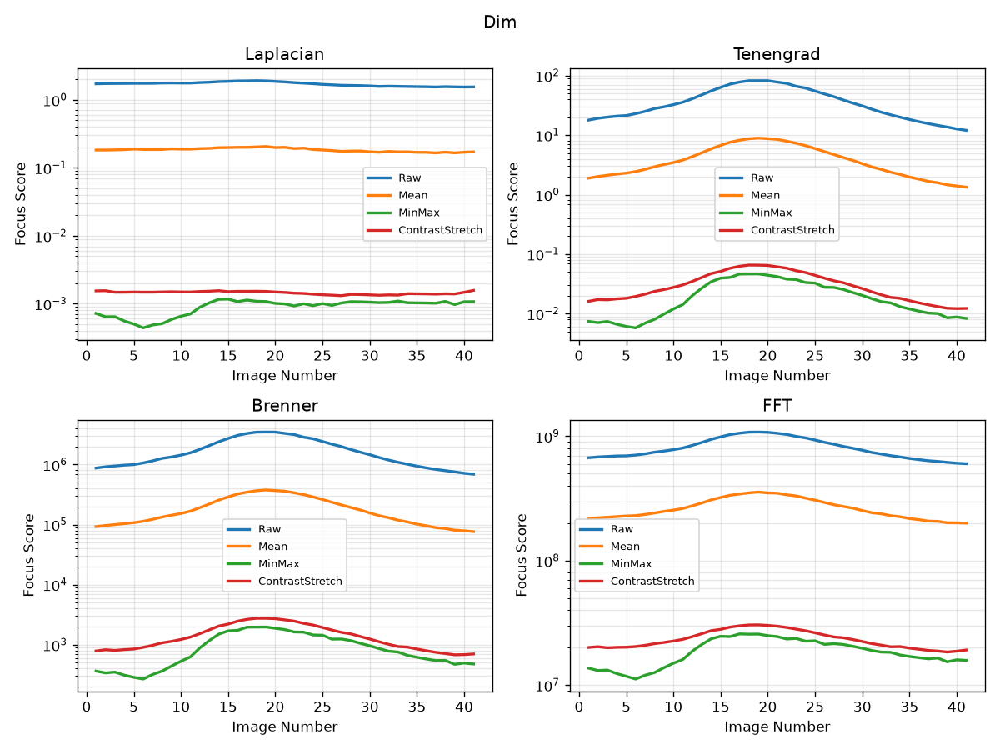
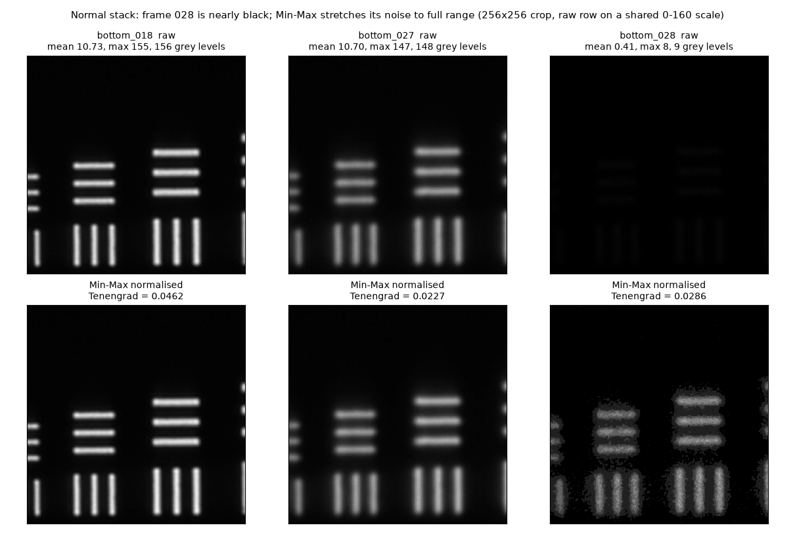
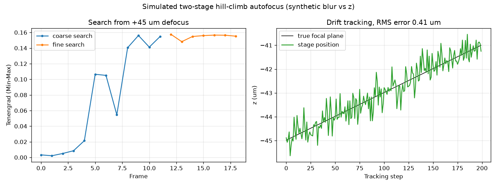

# Autofocus for phonon microscopy: focus metric selection and system design

Code and results for the final-year dissertation *Towards an Automated Autofocus System for Phonon
Microscopy: Metric Selection and System Design* (University of Nottingham).

A phonon microscope builds an image point by point, and a scan can take minutes to hours. Over that time,
thermal and mechanical drift moves the sample out of the focal plane, which degrades the data in a way that
only shows up afterwards. The project compares image-based focus metrics as the feedback signal for an
autofocus loop, selects one for real-time use, and designs the closed-loop hardware around it.

## Repository layout

| Path | Contents |
|---|---|
| [`matlab/`](matlab/) | The original MATLAB comparison script from the dissertation appendix. Only the dataset path was changed. |
| [`python/autofocus/`](python/autofocus/) | NumPy/OpenCV port: `metrics.py`, `normalise.py`, `sweep.py`, `control.py` (hill-climb controller), `synthetic.py`, `cli.py` |
| [`tests/`](tests/) | pytest suite: metric behaviour on synthetic blur, MATLAB parity, controller, and checks against the real dataset |
| [`results/`](results/) | Focus-curve figures, the results table, and MATLAB reference scores |
| [`demo/`](demo/) | Live webcam focus score, simulated hill-climb autofocus, host-side hardware loop |
| [`firmware/`](firmware/) | Microcontroller sketch for the stepper + piezo axis (rebuilt, see [Status](#status)) |
| [`data/sample/`](data/sample/) | Two frames from the Normal stack: `bottom_000` (defocused) and `bottom_018` (in focus) |

## Method

**Dataset.** A piezo stage moved the sample along the optical axis from 30,000 to 70,000 nm (a 40 µm sweep)
in 1,000 nm steps, imaged through a 20× objective. That gives 41 PNGs per stack (`bottom_000.png` to
`bottom_040.png`), so frame index is position along the focus axis. The sample is a resolution target. The
sweep was captured three times under different illumination: Bright, Normal and Dim.

**Pipeline.** Each frame is converted to grayscale and then to double precision. Each frame is then
normalised independently by one of four schemes:

| Normalisation | Operation |
|---|---|
| Raw | none |
| Mean | divide by the image's own mean |
| Min-Max | rescale to [0, 1] with the image's own min and max |
| Contrast Stretch | Min-Max, then stretch between the 1st and 99th percentile |

Four focus metrics are then computed:

| Metric | Definition |
|---|---|
| Laplacian | variance of the image filtered with `fspecial('laplacian', 0.2)` |
| Tenengrad | mean of Gx² + Gy² from 3×3 Sobel gradients (threshold T = 0) |
| Brenner | Σ (I(x+2, y) − I(x, y))² |
| FFT | sum of the FFT magnitude after zeroing a 61×61 low-frequency square at the centre |

That gives 16 combinations per lighting condition. The best-focus frame for each combination is the
argmax of its focus curve.

## Results

### Best-focus frame per combination

| Metric | Normalisation | Bright | Normal | Dim |
|---|---|---|---|---|
| Laplacian | Raw | 018 | 017 | 017 |
| Laplacian | Mean | 018 | 028 | 018 |
| Laplacian | Min-Max | 018 | 028 | **014** |
| Laplacian | Contrast Stretch | 018 | 028 | **040** |
| Tenengrad | Raw | 018 | 018 | 018 |
| Tenengrad | Mean | 018 | 028 | 018 |
| Tenengrad | Min-Max | 018 | 018 | 018 |
| Tenengrad | Contrast Stretch | 018 | 017 | 017 |
| Brenner | Raw | 018 | 018 | 018 |
| Brenner | Mean | 018 | 028 | 018 |
| Brenner | Min-Max | 018 | 018 | 018 |
| Brenner | Contrast Stretch | 018 | 028 | 017 |
| FFT | Raw | 018 | 018 | 018 |
| FFT | Mean | 018 | 028 | 018 |
| FFT | Min-Max | 018 | 028 | 016 |
| FFT | Contrast Stretch | 018 | 028 | 018 |

The original MATLAB script and the Python port both produce this table. Full best and mean scores are in
[`results/results_table.md`](results/results_table.md).

- **Bright:** every combination selects frame 018.
- **Normal:** Raw selects 017/018. Most normalised combinations select 028 (see the
  [re-analysis](#re-analysis-frame-028-in-the-normal-stack) below).
- **Dim:** Tenengrad, Brenner and FFT stay at 016–018. Laplacian becomes unstable: Min-Max selects 014 and
  Contrast Stretch selects 040.

### Focus curves (log y-axis, 2×2 per condition)

| Bright | Normal | Dim |
|---|---|---|
|  |  |  |

These are regenerated by the Python port. The dissertation's original MATLAB figures are in
[`results/dissertation/`](results/dissertation/).

### Computation time (MATLAB, from the dissertation)

Mean time per image for one metric evaluation, averaged over all three conditions:

| Metric | Time per image |
|---|---|
| Laplacian | 0.0130 s |
| Tenengrad | 0.0189 s |
| Brenner | 0.0202 s |
| FFT | 0.0458 s |

FFT is about 2.4× slower than Tenengrad (0.0458 / 0.0189). Tenengrad is slightly faster than Brenner in
MATLAB, probably because `imgradientxy` is optimised and Brenner uses plain array slicing. Timings
from the Python port are listed in `results/results_table.md`. They depend on the machine and library
and are not comparable with these.

## Key findings

1. **Tenengrad is the metric selected for real-time control.** It agreed with Brenner and FFT under all
   three lighting conditions, ran in 19 ms per image, and cost much less than FFT. It is used with a Min-Max
   (or Contrast Stretch) normalised input.
2. **Laplacian variance fails in low light.** It is the fastest metric, but under Dim illumination its
   Min-Max and Contrast Stretch variants select frames 014 and 040, far from the 016–018 cluster. The Laplacian
   is a second-order derivative, so it amplifies high-frequency content (including sensor noise) more than the
   first-order Sobel gradients in Tenengrad. As the signal level falls, noise makes up more of that content.
3. **Normalisation changes which frame is selected.** Under Normal illumination, normalised and raw versions of
   the same metric disagree. The dissertation concluded that per-image normalisation is necessary, so that
   brightness differences between frames cannot bias the score. The re-analysis below qualifies this.
4. **Metric choice matters more as light falls.** In Bright light every combination agrees. In Normal light the
   normalisation changes the answer. In Dim light the metric itself changes the answer.

### Re-analysis: frame 028 in the Normal stack

Rebuilding the analysis for this repository turned up something the dissertation did not discuss. Frame
`bottom_028.png` in the Normal stack is almost black: mean intensity 0.41, maximum grey level 8, and only
9 distinct grey levels, where neighbouring frames have a mean of about 10.7 and a maximum of about 150. It
looks like an under-exposed or dropped capture.



Per-image normalisation stretches those 9 grey levels across the full range, so quantisation and sensor noise
look like fine detail. That is why most normalised combinations pick 028. With that one frame excluded
(`autofocus compare ... --exclude bottom_028.png`), all 16 combinations select 017 or 018
([`results/normal_without_028/`](results/normal_without_028/results_table.md)).

What this means for the conclusions:

- In this dataset, the Normal-condition disagreement comes from one bad frame, not from brightness bias between
  good frames. Raw metrics selected 017/018 in all three conditions, so these stacks do not on their own show
  that normalisation is required. The argument for normalisation still stands for a live system, where exposure
  and illumination can change during a scan.
- Normalisation needs a guard. A frame with very little dynamic range should be rejected before it is scored,
  or it can win the argmax.
- Tenengrad with Min-Max, the combination selected for the hardware, already ranks frame 028 below the true
  focus (0.0286 vs 0.0462).

The same effect appeared in the hill-climb simulation. Far from focus, a heavily blurred frame loses contrast,
Min-Max stretches the remaining noise, and the normalised score can start rising again.

## Hardware design

The closed-loop system proposed in Chapter 6 of the dissertation:

```
camera frame ──► host PC: grayscale → Min-Max → Tenengrad score
                      │
                      ▼  serial
               microcontroller ──► stepper driver ──► lead screw   (coarse, mm range)
                      └──────────► DAC ──► piezo amplifier ──► objective positioner (fine, sub-µm)
```

- **Mechanics:** 3D-printed mount (PLA/PETG for a prototype, possibly aluminium later if the printed parts' own
  thermal expansion causes drift) holding the actuators and camera around the existing objective and stage.
- **Actuation:** two stages. A stepper motor with a lead screw makes coarse, millimetre-range corrections; a piezo
  objective positioner gives sub-micron, closed-loop fine focus over a shorter range.
- **Camera:** Raspberry Pi camera module for the prototype; a monochrome machine-vision camera for the final
  system, since every metric works on grayscale.
- **Control:** hill climbing. Capture a frame, score it, step in the direction that increases the score, repeat.
  The stepper handles large initial corrections; the piezo does fine search and then tracks drift during a scan.
  When the piezo nears the end of its travel, the stepper takes up the offset so the piezo can return to the
  middle of its range. FFT is reserved for occasional validation because it is about 2.4× slower than Tenengrad.

[`python/autofocus/control.py`](python/autofocus/control.py) implements this controller.
[`firmware/autofocus_controller/`](firmware/autofocus_controller/) is the microcontroller side. It accepts direct
stepper/piezo move commands and can also run the fine hill climb on the board, with the PC only sending the score
of each frame. [`demo/hardware_loop.py`](demo/hardware_loop.py) connects a camera, the scoring code and the board.

### Simulated autofocus

[`demo/simulate_hill_climb.py`](demo/simulate_hill_climb.py) runs the same controller against a simulated stage.
The simulated stage blurs a crop of the real in-focus frame as a function of z, with blur growing by 0.5 px/µm.
That rate was chosen so the Tenengrad curve falls off about as fast as the real Normal sweep does around frame 018.



From 45 µm out of focus, the coarse stepper search and the fine piezo search take 19 frames in total. The
controller then tracks 4 µm of drift over 200 steps with an RMS error of 0.41 µm. This is a simulation with a
simple Gaussian-blur defocus model; it shows that the control logic works, not how the real system performs.

## Status

| Part | Status |
|---|---|
| Metric and normalisation comparison | Complete. The MATLAB script and the Python port reproduce the dissertation table. |
| Python port | Raw, Mean and Min-Max scores match MATLAB to rounding error (relative error below 1e-14). Contrast Stretch matches to within 5e-5 relative error, because a few pixels fall on histogram bin edges. All 48 best-frame selections are identical. |
| Hill-climb controller | Implemented and tested in simulation. |
| Hardware | The dissertation covers the design. The system was built after submission, but no photos or original firmware survived. |
| Firmware and `hardware_loop.py` | **Rebuilt** from the design for this repository. Not run on the original rig. Pin numbers, DAC, piezo travel and lead screw pitch in `firmware/autofocus_controller/config.h` are placeholders. |

Limitations from the dissertation still apply. All results come from one sample (a resolution target) at one
magnification, and only three illumination levels were tested.

## Next steps

- Add a dynamic-range check that rejects dark or empty frames before scoring (see frame 028).
- Repeat the comparison on more samples, at more magnifications and over a wider range of illumination.
- Try Tenengrad with a non-zero threshold T in dim light; this dataset only used T = 0.
- Measure the loop on hardware: closed-loop response time, piezo settling time, camera exposure in dim light, and
  tracking accuracy against real thermal drift.
- Replace the placeholder values in `config.h` with the real build's values and test the firmware on the rig.

## How to run

```bash
python -m venv .venv
source .venv/bin/activate          # Windows: .venv\Scripts\activate
pip install -e ".[dev]"
pytest
```

Without the dataset, the tests use synthetic blur sweeps and the two sample frames. The dataset tests are skipped.

### Reproduce the results table

The full dataset (3 × 41 PNGs, about 150 MB) is not stored in git. Download `Magnification-2(size).zip` from the
repository's Releases page and unzip it into `data/` so the layout is
`data/Magnification-2(size)/{Bright,Normal,Dim}/bottom_000.png ...`. Then run:

```bash
autofocus compare "data/Magnification-2(size)" --out results
```

This prints the table, writes `results/results_table.md` and redraws the three focus-curve figures. The dataset
tests in `pytest` then also run. They check every best-frame selection against the dissertation and every score
against the MATLAB output in `results/matlab_scores/`.

Other commands:

```bash
autofocus score data/sample/bottom_018.png                 # all 16 scores for one image
python scripts/frame_028_figure.py                         # frame 028 figure (needs dataset)
```

In MATLAB (Image Processing Toolbox), with the dataset in place:

```matlab
run('matlab/focus_metric_comparison_original.m')
```

### Demos

```bash
python demo/simulate_hill_climb.py                  # writes results/hill_climb_simulation.png
python demo/simulate_hill_climb.py --start-offset 70 --drift 0.03 --show

pip install opencv-python                           # GUI build of OpenCV, needed for the webcam window
python demo/webcam_focus.py --camera 0              # q quit, m change metric, n change normalisation

pip install -e ".[hardware]"                        # pyserial
python demo/hardware_loop.py --port COM5 --camera 0 --mode mcu --track
```

The firmware builds with the Arduino IDE or `arduino-cli` for any board with I²C, for example an Uno or Nano.
Open `firmware/autofocus_controller/autofocus_controller.ino`. The serial protocol is documented at the top of
that file.

## Licence

MIT. See [LICENSE](LICENSE).
